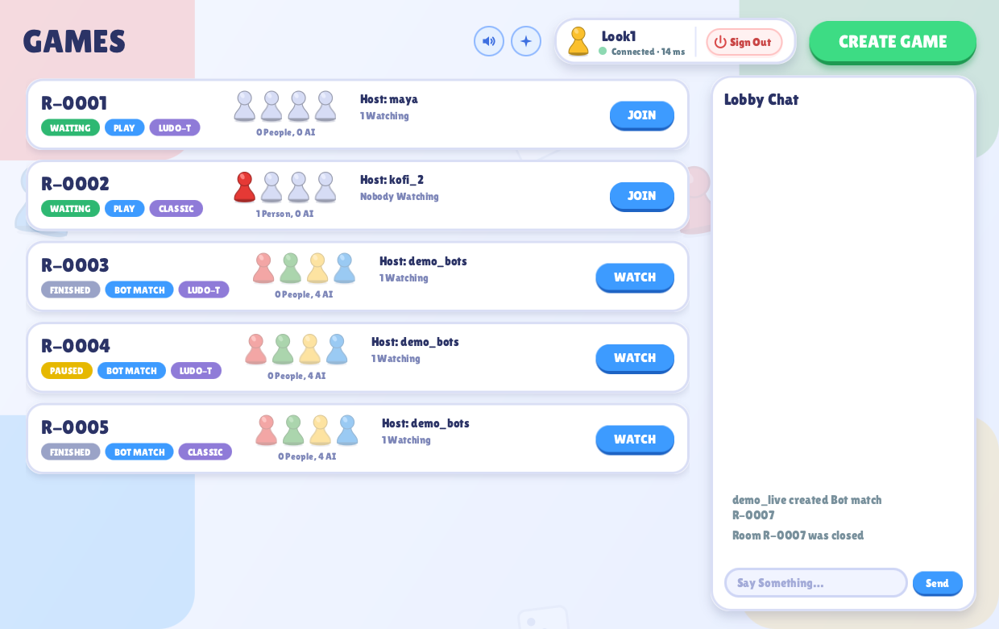
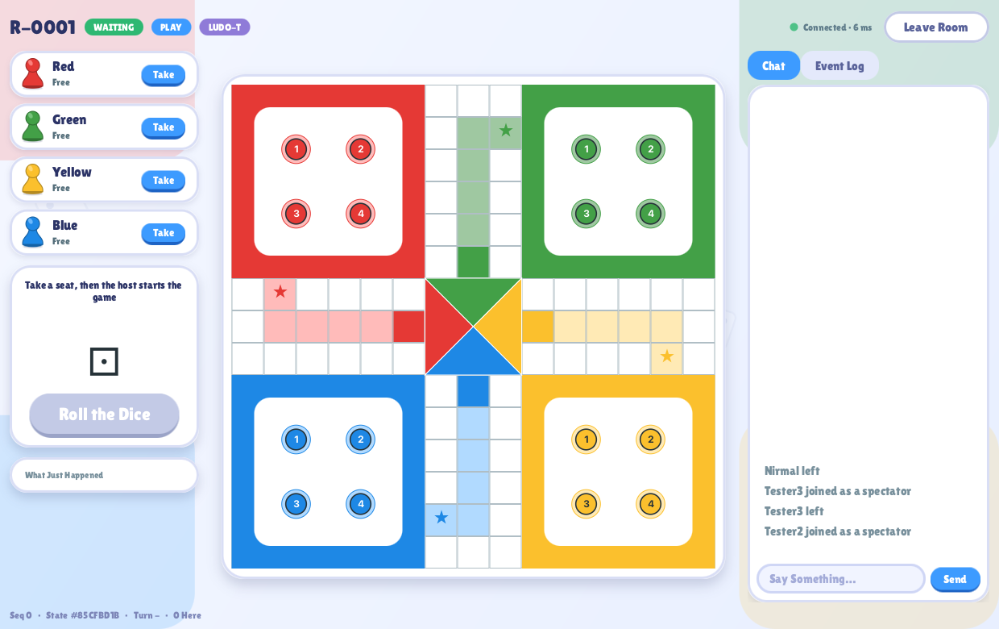
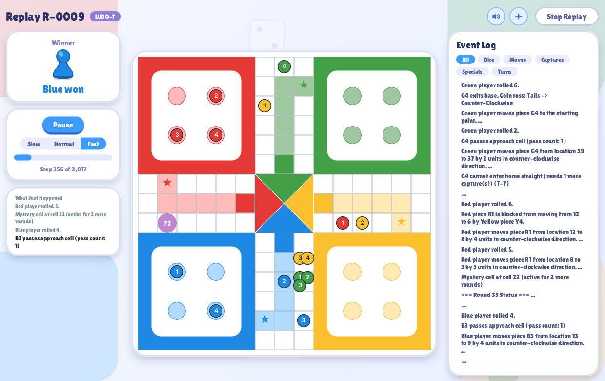
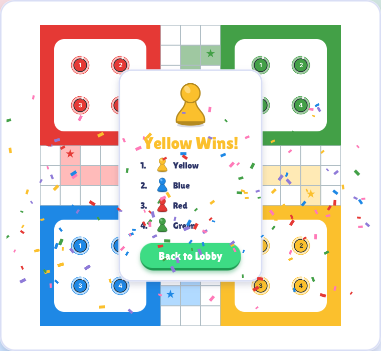

<p align="center"></p>

<h1 align="center">LUDO-T Online</h1>

<p align="center">
A multiplayer take on Ludo with a twist: blockades, mystery cells and special effects.<br>
Play against friends and AI from a JavaFX desktop client, on a server that handles many rooms at once.
</p>

<p align="center">
  
  
</p>

## What it is

LUDO-T is a modified Ludo with extra rules (below). It started as a single-machine console simulation and is now a
**networked game**:

- a **desktop client** (JavaFX) with a lobby, game rooms, chat and replays,
- a **game server** that owns the rules and the state, so nobody can cheat from the client,
- an optional **PostgreSQL database** that stores every game so it can be replayed later,
- **bots and a stress tool** that act as automatic clients.

### What you can do

- Create a room, take a seat (red, green, yellow or blue), and let AI fill the empty seats.
- Play with people on other computers, or watch a game as a spectator, with room chat and a lobby chat.
- Watch **bot matches** at three speeds, with a "what just happened" panel and a filterable event log
  (Dice, Moves, Captures, Specials, Turns).
- **Reconnect** if your Wi-Fi drops: the window stays put, retries, and gives you your seat back.
- Open **Finished Games** and **replay** any stored game with pause, speed control and a progress bar.
- Hear sounds and see small motion effects (all synthesised in code), each with its own on/off switch.

### The twist

On top of classic Ludo, LUDO-T adds blockades (two or more of your pieces on one cell move together and block
opponents), mystery cells that teleport or hand out effects (energised, sick), a briefing area pieces must escape
from, and a forced break-up of blockades after three sixes in a row.

<p align="center">
  
  
</p>

## The rules

You can play either rule set; pick it when you create a game (*LUDO-T* or *Classic*). Both use four colours, four
pieces each, and a 52-cell loop with a five-cell home straight per colour.

### Classic

| | |
|---|---|
| Direction | Everyone moves **clockwise**. |
| Leaving base | Roll a **6** to bring a piece out onto your start cell. |
| Bonus rolls | A 6 gives you another roll. **Three 6s in a row** are penalised (no further bonus). Capturing also gives another roll. |
| Capturing | Landing exactly on a **single** opponent piece sends it back to its base. |
| Own pieces | You cannot land on your own piece, so there are no blockades. |
| Home | A piece enters the home straight after passing its approach cell and must reach the final cell by an **exact** roll (no overshooting). First to bring all four pieces home wins. |

### LUDO-T (the twist)

Everything in Classic, plus these rules (the **T-n** tags are the identifiers used in the game log and the tests):

| Rule | What it does |
|---|---|
| **T-1** Direction | When a piece leaves base a **coin toss** decides if it travels clockwise or counter-clockwise. A counter-clockwise piece must pass its approach cell **twice** before it may turn into the home straight. |
| **T-2** Bonus on capture | A capture earns another roll. |
| **T-3** Blockades | Two or more pieces of one colour on the same cell form a **blockade**; opponents cannot land on it or pass through it. |
| **T-4** Moving a blockade | A blockade moves as one: it advances **roll ÷ size** cells (rounded down), so a block of 3 needs a roll of at least 3 to move. |
| **T-5** Breaking a blockade | When a blockade splits, each piece goes back to the direction it had before. |
| **T-6** Triple six | Rolling **three 6s in a row** forces one of your blockades to break up. |
| **T-7** Earning home | A piece may only enter the home straight after it has **captured at least once**. |
| **T-8** Block against block | A blockade can only be captured by an opposing blockade of **exactly the same size**. |
| **T-9** Capture | A captured piece (or blockade) goes back to its base. |
| **T-10** Mystery cell | A **mystery cell** appears on a random cell and stays for **4 rounds**. |
| **T-11** Teleport | A piece that lands on it is teleported to a special cell: the start cell, **Alpha**, **Beta** or **Gamma**. |
| **T-12** Alpha | The piece becomes **Energised** (moves twice as far) or **Sick** (moves half as far) for 4 rounds. |
| **T-13** Beta | The piece must attend a **briefing**: it cannot move for 4 rounds, unless it rolls **three 3s in a row**, which sends it to base early. |
| **T-14** Gamma | The piece **reverses direction**. |
| **T-15** Expiry | After 4 rounds the mystery cell disappears. |

## Try the rules: scenario seeds

Every game is fully reproducible from its **seed**: the same seed always produces the same dice and the same game.
These four seeds each show particular rules clearly. Run one in the console with no server at all:

```bash
./run.sh 1 > game_log.txt        # a narrated log of a whole game; then search it for the lines below
```

...or create a **Bot match** in the client and type the seed into *Seed (Optional)* to watch it happen on the board.

| Seed | What it demonstrates | A line to look for in the log |
|---|---|---|
| `1` | The core rules: T-1 direction, T-2 bonus, T-3/T-4 blockades, T-5 break, T-6 triple six, T-7 home entry refused, T-8 block capture, T-9 capture, T-10/T-11 mystery cells, T-14 Gamma, T-15 expiry | `G1 forms a blockade with G2 at cell 39 (T-3)` |
| `2` | T-12 Alpha makes a piece **Sick**; T-13 Beta sends a piece to **briefing** | `Red piece R1 feels sick, and movement speed halves.` |
| `3` | T-12 Alpha makes a piece **Energised** | `Yellow piece Y4 feels energized, and movement speed doubles.` |
| `2069` | The rare T-13 **early escape** from briefing with three 3s (also the demo game stored by `./run-dbtool.sh reset`) | `Teleporting piece R3 to base.` |

The recorded logs of these seeds are kept in `test-resources/golden/` and checked by the tests, so the rules cannot
change by accident. The [developer guide](docs/DEVELOPER_GUIDE.md#the-ludo-t-rules-and-scenario-seeds) lists
every rule with its exact log line.

## Quick start

You need **Java 17 or newer** (`java -version`). The scripts are for macOS and Linux; each has a `.bat`/`.ps1`
twin for Windows that has not been tested.

```bash
git clone <this repository>
cd Ludo-T

./download-tools.sh      # once: JavaFX, JUnit, the JDBC drivers and the analysis tools into lib/ and tools/
./compile.sh             # builds dist/*.jar

./run-server.sh          # terminal 1: the game server (no database needed to try it out)
./run-client.sh          # terminal 2: a game window; run it again for a second player
```

In the window: type a nickname, **Connect**, **Create Game**, take a seat, **Start Game**, then roll and click a
glowing piece. Games are not stored unless you configure a database (below).

### Play with someone else

Run the server on one computer and give the other person the client:

```bash
./run-client.sh --host <the server's IP address> --port 5555
```

Both computers must be able to reach each other on port 5555 (the same Wi-Fi works).
See the [developer guide](docs/DEVELOPER_GUIDE.md#two-machines) for what the second computer needs.

### Store games in a database (optional)

Without a database everything works except **Finished Games** and **Replay**. To switch it on:

```bash
cp config/server.properties.example config/server.properties
# edit it: db.url, db.user, db.password   (this file is git-ignored: never commit it)
./run-dbtool.sh reset    # creates the tables and a finished demo game
./run-server.sh
```

Any PostgreSQL works (the project was built against Supabase). For a fully offline option there is a local H2
database: `./run-h2.sh`, see the [developer guide](docs/DEVELOPER_GUIDE.md#the-database).

## Bots and stress testing

Create a Play room in the client first, then let bots take the seats:

```bash
./run-bots.sh R-0001                       # four bots, one per colour, play the room you created
./run-stress.sh --create --name stressA --seat RED --speed fast --start-game
```

The bots each have a style (Red goes for captures, Green for blockades, Yellow races home, Blue is random). The
stress client floods a room with fast, concurrent and deliberately wrong requests and checks every answer; the
[developer guide](docs/DEVELOPER_GUIDE.md#automatic-clients) has all the options.

## How it works

```
 JavaFX client (many)  <---- TCP ---->  Server  <---- JDBC ---->  PostgreSQL
 (bots and stress tool,                 one actor per room,        games, decisions,
  same protocol)                        queues everywhere          chat
```

- **The server is authoritative.** Clients send requests ("roll", "move piece 2"); the server validates them and
  pushes the result to everyone in the room.
- **One actor per room.** Each room has its own single-thread queue, so thousands of requests to one room are
  handled in order without locks, and a busy room never slows another down. A client that cannot keep up is
  disconnected instead of stalling anyone else.
- **Every push has a sequence number**, so a client notices a gap and asks for a fresh snapshot.
- **Storage is asynchronous and idempotent**: games are written in batches by a background thread, so the
  database is never on the path of a move.
- **Replays re-run the game.** The engine is deterministic: a stored seed plus the recorded decisions replay to
  the same result, and a replay that disagrees with the record stops rather than showing a wrong game.

The code is split into modules that depend only on what they should (the compiler enforces it):

| Module | Role | Depends on |
|---|---|---|
| `core` | The game rules and engine (no I/O) | nothing |
| `protocol` | Messages, DTOs, framing, the shared connection | nothing |
| `server` | Rooms, lobby, connections, replays, database access | `core`, `protocol` |
| `client` | The JavaFX app | `protocol` |
| `bot` | Bots and the stress client | `protocol` |

## Design patterns

| Pattern | Where it is used |
|---|---|
| **Abstract Factory** | `ClassicRuleEngineFactory` and `LudoTRuleEngineFactory` build the whole rule set for each variant. |
| **Builder** | `GameBuilder` assembles one game (players, seed, rules, event bus) per room. |
| **Strategy** | The AI of each colour, the random-number source, and the decision source (human, AI or scripted replay). |
| **Command** | Every move is a `Move` object (`MoveOnBoard`, `CaptureMove`, `BlockMove`, ...); room requests are queued as commands. |
| **State** | A piece's life cycle (base, track, home straight, briefing) and a room's status and turn phase. |
| **Observer** | Each game publishes events on an `EventBus`; the lobby and room subscribers receive them. |
| **Visitor** | Game events are turned into network messages by one visitor and into console text by another. |
| **Decorator** | `AsyncGameRepository` wraps the database writer to make storage asynchronous. |
| **Active Object / Actor** | Each room (`GameSession`) owns a private thread that processes its command queue in order. |
| **Producer-Consumer** | The outbound queue of every connection, the room command queues and the database write queue. |

## Tests

```bash
./test.sh                # about 660 tests across all modules
./run-metrics.sh         # coverage and static analysis (Checkstyle, PMD, SpotBugs)
./run-evidence.sh        # a recorded stress run against a live server and database
```

Highlights: golden game logs that pin the rules, concurrency tests for the room queues, reconnect and replay
tests over real sockets, and a test that replays a game stored in SQL and checks it ends identically.

## Repository layout

```
src/{core,protocol,server,client,bot}/   the five modules
test/                                    tests, one folder per module (+ integration)
test-resources/golden/                   recorded games used as rule tests
db/                                      schema, seed and reset SQL
config/                                  server.properties.example (your real one is git-ignored)
docs/                                    developer guide and images
*.sh / *.bat / *.ps1                     build, run and test scripts (no Maven or Gradle needed)
```

## More documentation

- [Developer guide](docs/DEVELOPER_GUIDE.md): configuration reference, database set-up, the automatic clients,
  metrics, troubleshooting and the game-rule scenarios.

## Status

Under active development. Known limits: there are no accounts (a nickname is your identity), the network
protocol is plain TCP with Java serialization behind an allow-list (JSON over TLS would be the production choice),
and one server instance owns the database. No licence has been chosen yet.
